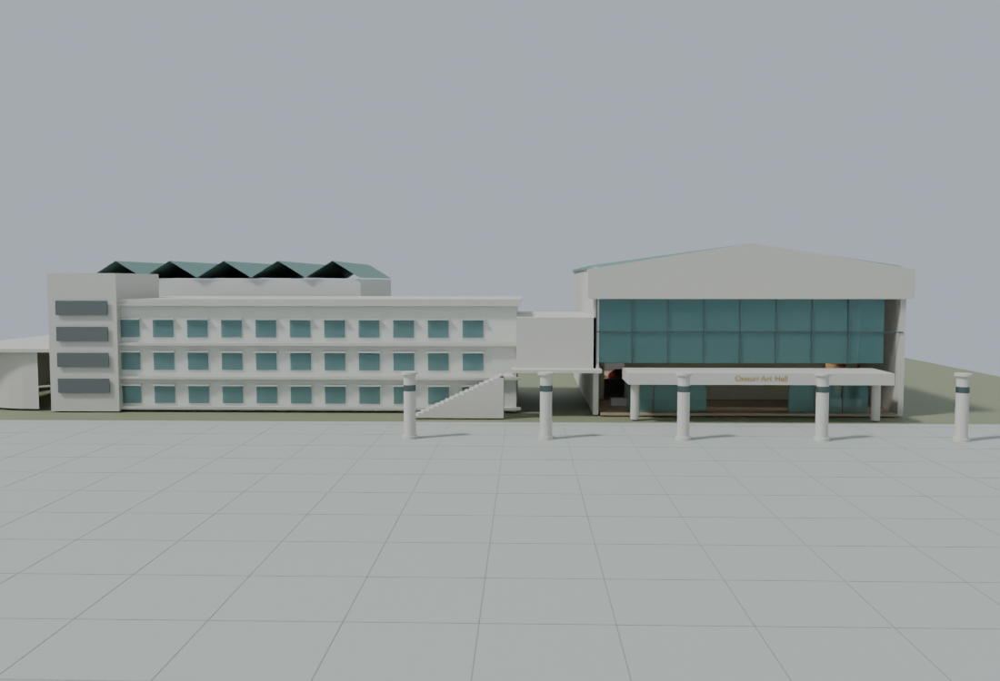
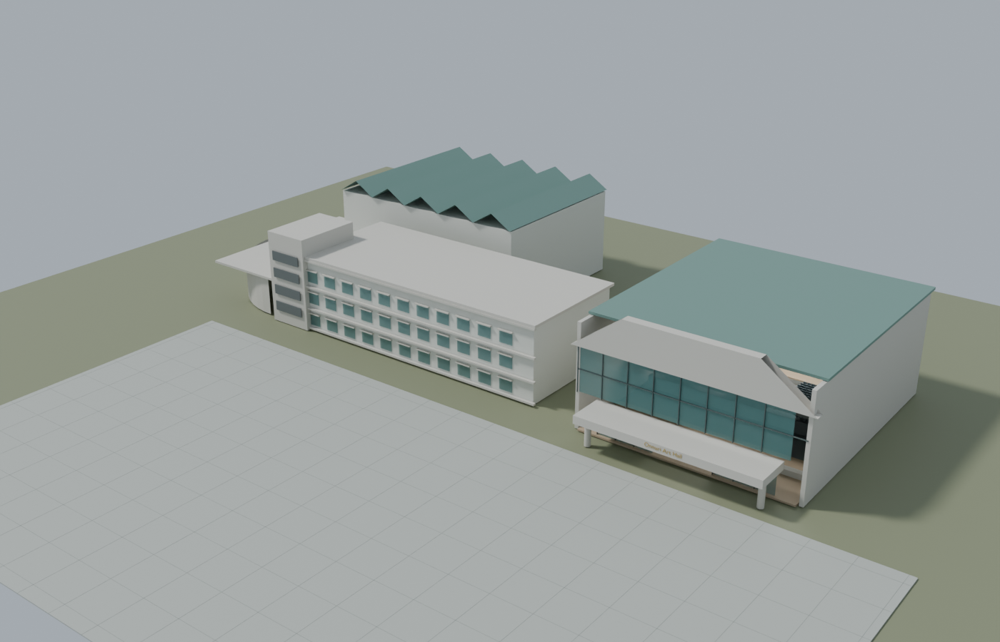
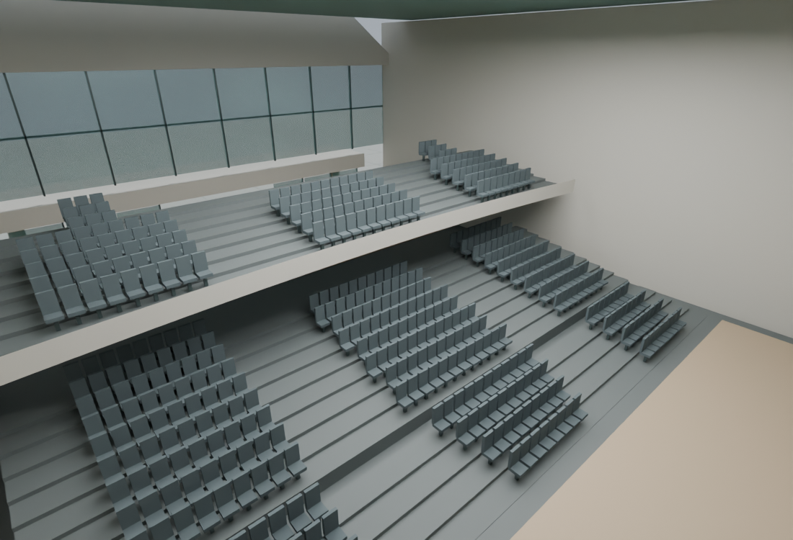
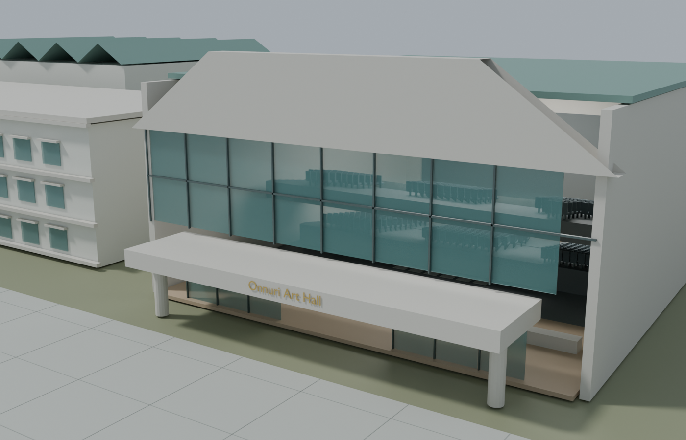
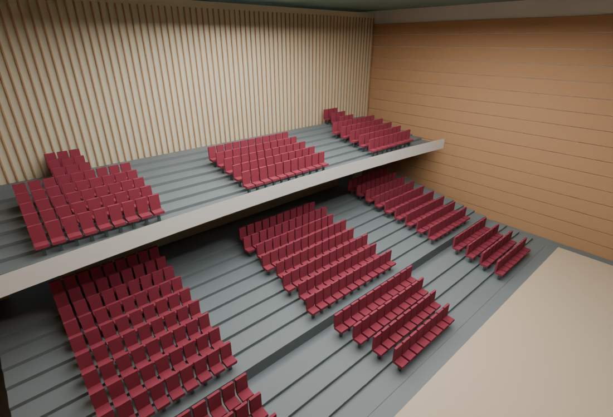
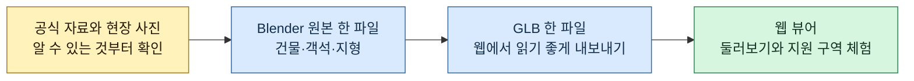

# 수원청소년문화센터 디지털 트윈

**수원의 청소년문화센터를, 방문하기 전에 한 번 둘러보는 비공식 3D 지도.**

제가 해 온 3D 제작 경험에서 영감을 얻었습니다. 학교가 12월 초 이곳으로 교육을 받으러 갈 예정이라, 처음 오는 사람도 광장과 공연장 입구를 미리 보고 어디로 이동하는지 감을 잡을 수 있는 공간을 만들고 싶었습니다. 제 고향 수원의 청소년 시설을 알리는 마음도 담았습니다. 나중에는 대중교통에서 내려 시설까지 오는 길도 연결해 보고 싶습니다.

> 수원시·수원시청소년청년재단의 공식 서비스가 아닙니다. **미리 둘러보는 참고용**입니다. 실제 개방 여부, 수업 장소, 접근 가능한 길, 안전 대피는 시설의 공식 안내를 따르세요. [시설 공식 안내](https://www.syf.or.kr/web/page.do?menuIdx=360)

## 지금 볼 수 있는 것

전면 광장의 첫 골격, 연수동과 온누리아트홀 외관, 로비와 공연장 객석·무대를 한 장면으로 연결합니다. 위치 버튼으로 공간을 옮겨 볼 수 있고, **로비 걸어보기 · 근사**를 누르면 모델에 표시된 로비 일부에서 움직일 수 있습니다. 공연장 객석은 시점 버튼으로만 이동합니다. 온누리의 1·2층 좌석은 2017년 객석도의 번호석 **519개와 휠체어 공간 6곳**을 반영했습니다. 정확한 현재 치수·배치·마감과 보행 가능 범위는 [검증 기록](docs/FIRST-PASS.ko.md)과 [출처 장부](docs/SOURCES.ko.md)에 구분해 놓았습니다.

## 스틸컷



각 이미지는 실제 Blender 모델에서 렌더한 기록입니다. 완성 사진이 아니며 해당 모델 단계의 차이를 보여 줍니다.

|부지와 정면|온누리 객석|
|---|---|
|||
|||

[전체 스틸컷과 변경 설명](docs/STILLS.ko.md)

## 어떻게 만들었나



그림의 모든 건물은 **Blender 한 파일**에서 나옵니다. 웹은 그 모델을 읽어 보여 줄 뿐, 없는 건물을 따로 그려서 채우지 않습니다. 이 사이트는 데이터베이스나 사용자 로그인 없는 **정적 웹**으로 구성합니다.

## 문서

- [처음 오는 분을 위한 쉬운 이용 안내](docs/GUIDE.ko.md)
- [일을 나누어 진행하는 상세 계획](docs/MILESTONES.ko.md) · [첫 통합 개발기](docs/FIRST-PASS.ko.md)
- [공식 자료와 객석도 읽은 결과](docs/SOURCES.ko.md) · [현장 사진 관찰](docs/RECENT-REFERENCES.ko.md)
- [Blender 모델 개발기](docs/MODEL-PHASES.ko.md) · [M3 재료 개발기](docs/M3-MATERIALS.ko.md) · [뷰어 개발기](docs/viewer/IMPLEMENTATION.ko.md)
- [기여 안내](CONTRIBUTING.md) · [MIT 라이선스](LICENSE) · [모델·텍스처 라이선스](ASSET-LICENSES.md)

## 운영 배포

온전히 정적 파일을 배포합니다. GitHub `main`을 Cloudflare Pages에 연결하고, `npm ci && npm run build` 결과인 `dist/`를 제공합니다. 운영 주소: [twin.sycc.rhee.life](https://twin.sycc.rhee.life). [배포·검증 개발기](docs/RELEASE.ko.md)

## 로컬 실행과 모델 편집

Node.js 22.12 이상과 npm이 필요합니다. `npm ci`로 의존성을 설치하고 `npm run dev`로 웹을 엽니다. `npm test`, `npm run test:model`, `npm run build`로 확인할 수 있습니다.

네이티브 원본 `models/sycc.blend`는 **Blender 5.3.0**으로 제작·확인했습니다. Blender 4.3.2는 이 파일을 열지 못했습니다. 웹용 `public/models/sycc.glb`를 볼 때는 Blender가 필요하지 않습니다.

```sh
blender -b models/sycc.blend -t 4 -P blender/scripts/render_still.py -- --waypoint Overview --out renders/recheck.png --width 900 --samples 8
```

위 명령은 모델을 덮어쓰지 않고 PNG만 만듭니다.
