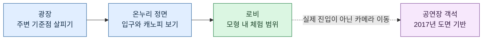

# 처음 오는 분을 위한 3D 이용 안내

이 프로젝트는 학교의 12월 초 교육 방문을 앞두고, 수원의 청소년문화센터를 미리 보고 싶은 사람을 위해 만든 독립 모형입니다. 실제 길찾기나 안전지도가 아닙니다.

1. **전체 보기:** 먼저 광장, 연수동 창열, 오른쪽 온누리아트홀의 삼각 정면을 찾습니다.
2. **입구 보기:** 위치 버튼으로 온누리 입구와 로비의 위치 관계를 살펴봅니다.
3. **객석 보기:** 옛 객석도에서 확인한 1층·2층 구획을 카메라로 봅니다. 모형의 좌석이 현재 예매 가능한 좌석이나 실제 입장 순서는 아닙니다.
4. **실내 체험:** **로비 걸어보기 · 근사**를 눌러 시작합니다. 컴퓨터에서는 WASD 또는 방향키로 움직이고 드래그로 둘러봅니다. 휴대폰에서는 화면 이동 버튼을 누르세요. **전체 보기**로 보행을 종료합니다. 보행은 모델에서 확인한 로비 평면 일부에만 적용합니다. 계단, 출입문, 전체 건물 통과는 아직 실제 이동을 안내하지 않습니다. 실제 교육 일정이나 출입은 [시설 공식 안내](https://www.syf.or.kr/web/page.do?menuIdx=360)를 확인하세요.

## 다음에 하고 싶은 것

- 최신 사진과 시설 안내에서 확인된 공간부터 범위를 넓힙니다. 서로 다른 시기의 사진을 현재 모습으로 섞지 않습니다.
- 방문자가 버스나 철도에서 내려 어디로 가는지 알려 주는 대중교통 기능을 검토합니다. **현재는 연결하지 않았습니다.**
- 시각적으로 약한 부분, 실제 현장과 다른 곳이 있다면 [출처와 확인 위치](SOURCES.ko.md)를 함께 기록해 개선합니다.
