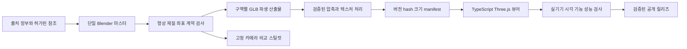

# 수원청소년문화센터 디지털 트윈: 마일스톤과 구현·검증 계획

작성일: 2026-11-19 UTC  
대상 저장소: `hslcrb/twin.sycc.digital`  
문서 상태: **착수 계획**. 아래 체크리스트, 성능 수치 및 검증 기준은 목표이며, 실제 구현·통과·배포 완료를 의미하지 않는다.

## 1. 프로젝트 목표와 지켜야 할 원칙

수원청소년문화센터와 온누리아트홀을 중심으로 부속시설, 외부 보행 공간, 공개된 내부 공간을 하나의 연속적인 3D 장소로 구현한다. 건물 외관만 보여주는 모형이 아니라 바깥에서 접근하고, 입구를 통과하고, 로비와 공개 실내를 탐색하며, 창을 통해 다시 외부를 볼 수 있는 경험을 목표로 한다. 다만 공개 자료로 확인하지 못한 공간을 실제와 동일하다고 단정하지 않는다.

장면 제작의 단일 원본은 Blender 마스터 파일이다. 웹은 마스터에서 내보낸 GLB를 표시하고 카메라·입력·상호작용·렌더 품질을 제어한다. 도로, 수목, 주변 건물, 지형, 계단이나 유리 프레임을 웹 코드에서 별도로 만들어 Blender에 없는 또 다른 세계를 유지하지 않는다. 성능 최적화를 위해 GLB를 구역별로 나누더라도 모든 구역은 같은 마스터의 좌표와 형상에서 나온 파생 산출물이어야 한다.

예쁜 화면과 실제 장소의 정확성은 별개의 평가 항목이다. 먼저 규모·배치·실루엣·동선이 맞는지 확인하고, 그 위에 재료·조명·수목·하늘·세부 장식을 쌓는다. 사진 한 장과 닮은 카메라 각도를 선택하는 것만으로 전체 정확성을 입증하지 않는다. 성능도 평균 FPS 하나로 평가하지 않고 다운로드, 첫 사용 가능 시점, 프레임 지연, 메모리, 장시간 안정성을 함께 기록한다.

## 2. 착수 시 확인한 공식 자료와 그 한계

확인 기준일은 위 작성일이며, 다음은 공식 시설 소개에서 확인한 **계획 수립용 사실**이다. 최신 사진이나 도면을 검토했다는 뜻은 아니다.

|참조|공식 출처|계획에 사용하는 정보|사용 한계|
|---|---|---|---|
|S01|[재단 시설이용안내](https://www.syf.or.kr/web/page.do?menuIdx=360)|문화센터의 시설 구성 및 온누리아트홀 층수 안내|시설 목록은 실제 평면도·치수·동선의 증명이 아님|
|S02|[재단 층별안내](https://yeyak.syf.or.kr/www/102)|본관과 별도 문화·체육시설을 함께 조사해야 하는 범위|페이지 내 일부 공통 템플릿 문구가 다른 시설명으로 보이므로 본문과 타 공식자료 교차확인|
|S03|[재단 대관안내](https://www.syf.or.kr/web/page.do?menuIdx=363)|온누리아트홀 525석, 은하수홀 92석 안내|좌석 수만으로 좌석 행·열·장애인석 위치를 추정하지 않음|
|S04|[수원문화재단 문화지도](https://www.swcf.or.kr/swdb/?p=8_view&page=8&reqIdx=202011091053071341&schCate1=F&schCate2=24)|온누리아트홀의 객석·분장실·음향실·조명 관련 시설 소개|실제 실 배치 및 현재 운영 상태는 별도 확인|
|S05|[수원시 공공시설 예약안내](https://www.suwon.go.kr/web/reserv/faci/view.do?q_cateCode=1216&q_currPage=4&q_rowPerPage=12&seqNo=142)|동일 시설의 명칭과 대관대상 교차확인|예약 시스템과 연동하거나 실제 예약 기능을 제공하는 것은 이 계획 범위가 아님|
|S06|[재단 시설·프로그램 소개 게시물](https://www.syf.or.kr/web/board.do?bbsIdx=70462&menuIdx=320)|추가 시각자료 조사 출발점|본문의 이미지는 아직 이 문서에서 전수 시각 검토한 것으로 취급하지 않음|

온누리아트홀은 공식 안내에서 지하 1층·지상 2층으로 소개된다. 시설군에는 한아름도서관, 새천년수영장, 꿈의체육관 등이 함께 나타나므로 본관과 공연장만 모델링하고 나머지를 임의의 상자로 채우는 방식은 피한다. 시설별 현재 명칭, 독립동 여부, 연결부, 출입구 및 공개 탐방 가능 구역은 조사 장부에서 확정한다. 공원과 연결되는 경계는 모델 범위를 정할 때 검토하되, 처음부터 주변 도시 전체를 확정 범위로 늘리지 않는다.

**아직 미확인인 항목:** 정밀 부지 경계, 측량 기준점, 각 동의 정확한 높이와 처마·옥상 형상, 모든 방향의 창호 모듈, 층별 최신 평면, 공연장 좌석 행·열, 승강기 위치·규격, 내부 마감재 사양, 외부 수목 수종과 위치, 준공 후 개보수 시점. 모르는 값은 `unknown`으로 남긴다. 신뢰할 수 있는 도면이 없을 때는 관찰 기반 재현이라는 한계를 명시한다.

### 2.1 교차조사에서 확인한 불일치와 우선 반영사항

공식 주소는 **수원시 팔달구 권광로 293(인계동 334-1)**이다. 공식 시설안내의 연수동은 지하1·지상3, 온누리아트홀 지하1·지상2, 새천년수영장 지하1, 꿈의체육관 지상2로 소개된다. 무지개광장·농구장·인라인장과 인접 청소년문화공원의 연결도 조사 범위에 넣는다. 이 층수는 기본 분류 근거이지 각 층 높이나 실제 기하 치수를 의미하지 않는다.

**공식 자료끼리도 수치가 다르다.** 본사이트의 연면적19,162.86㎡와 예약사이트의5개동17,462.67㎡ 표기는 범위나 갱신 시점 차이가 해소되지 않았다. 어느 값을 임의로 골라 전체 모델 면적을 맞추지 않는다. 현재 공연장은525석(휠체어석6 포함) 안내가 있으나, [2017년 공식 도면 게시](https://www.syf.or.kr/web/board.do?bbsIdx=48618&menuIdx=331)의 첨부파일명에는519석이 나타난다. 해당 게시물에는 객석1·2층, 무대 평면·측면 자료가 있지만 과거 도면을 현재 배치라고 확정해서는 안 된다. 착수 뒤 공개 이미지를 직접 읽은 결과, 역사 도면은 번호석 519석과 별도 휠체어 6자리를 구분한다. 두 값을 더하면 현행 안내의 525자리다. [출처 장부](SOURCES.ko.md)에 층과 구획별 산술 검증을 적었다. 집계는 재현하되 현재 치수나 배치까지 확인된 것으로 표시하지 않는다.

[2026년3월 수영장 리모델링 현장기사](https://news.suwon.go.kr/?p=40&reqIdx=202603241758449662&viewMode=view)는 지붕·수조 개선을 다루므로 오래된 수영장 사진을 현재 재료·형상 근거로 사용하기 전에 대조한다. 해당 시민기자 기사는 현장 참고자료이며 시설의 모든 치수를 인증하는 기술도면이 아니다. [2026년 시설홍보 게시물](https://www.syf.or.kr/web/board.do?bbsIdx=70462&menuIdx=320)의 여러 사진 역시 각각 촬영 위치·시점·이용권한을 확인한 뒤 모델 근거에 연결한다.

첫 공개 제품은 **근거 기반 블록아웃**으로 구분한다. 아직 모델에서 실행하지 않은 입구→로비→객석 이동은 '검증된 관람 경로'가 아니다. 기본 뷰어와 임시 충돌이 작동하는 것, 실제 시설과 동선이 일치하는 것, 배포 사이트에서 동일하게 동작하는 것은 각각 별도의 통과 조건이다.

## 3. 자료 조사와 정확성 등급

### 3.1 조사 순서

1. 공식 시설 소개, 층별 안내, 대관 자료, 공개 배치도에서 명칭과 기본 구조를 확인한다.
2. 최근 촬영된 공식 사진과 행사 기록으로 출입구·로비·객석·외벽·광장 등의 현재 모습을 찾는다.
3. 촬영 시점이 명확한 일반 공개 사진과 영상으로 다른 방향을 보완한다. 게시 날짜와 실제 촬영 날짜를 분리한다.
4. 공개 지도·항공사진은 배치와 방향의 참고로 사용하되 사용 조건을 기록한다. 지도 화면을 그대로 텍스처로 구워 넣거나 출처 의무를 지우지 않는다.
5. 서로 다른 시점의 증거가 충돌하면 최근 개보수 여부를 조사하고, 해결 전까지 어느 한쪽을 사실로 확정하지 않는다.
6. 정면·좌측·우측·후면·위에서 본 모습·접근 보행 시점의 증거 공백을 표로 남긴다.

### 3.2 자료 장부 필드

각 참조는 `sourceId`, URL, 발행기관·작성자, 게시일, 확인된 촬영일, 접근일, 해당 시설, 카메라 방향, 관찰 항목, 이용허락·라이선스, 저장 허용 여부, 파일 SHA256, 적용 모델 오브젝트 ID를 기록한다. 내려받을 권한이 확인된 자료만 저장소에 동봉한다. 출처 링크를 적는 것과 원본 사진을 공개 재배포할 권리가 있는 것은 별개다. 보관할 수 없는 자료는 URL·관찰 메모만 기록한다.

모델 오브젝트에는 다음 상태를 둔다.

- `measured`: 공식 치수나 허가된 실측 근거가 있음.
- `observed`: 사진·영상에서 형태와 존재가 확인됨. 치수는 추정일 수 있음.
- `inferred`: 인접 요소와 원근 관계 등으로 추론한 보완 형상.
- `placeholder`: 기능 개발을 위한 임시 형상. 사실적인 완성본으로 공개하지 않음.
- `unknown`: 자료가 부족하여 만들지 않았거나 범위를 확정하지 못함.

정확성 보고는 이 등급별 개수와 가시 면적을 함께 사용한다. 단순한 오브젝트 수는 창문 수천 개로 쉽게 부풀려질 수 있으므로 시설별 주요 특징 목록도 별도로 유지한다. '100% 동일'은 실측·전체 시각증거가 없으면 사용하지 않는다.

## 4. 범위와 우선순위

### P0: 장소를 알아볼 수 있는 기본 구조

- 문화센터 부지의 공용 접근 공간과 주요 동 배치.
- 온누리아트홀의 실루엣, 주 출입부, 외벽 재료 분할, 창호, 계단과 경사로.
- 문화센터 본관 외관과 주요 출입구.
- 시설 간 연결 보행로, 단차, 외부 광장과 주요 경계.
- 지면을 뚫거나 벽을 통과하지 않는 기본 보행 및 자유 관찰 카메라.

### P1: 핵심 내부와 부속동

- 공개 자료로 확인된 로비·복도·공연장 객석·무대의 공간 관계.
- 도서관·체육관·수영장 등 시설군의 외관과 확인 가능한 공개 내부.
- 창호를 통한 안팎 시야, 문의 실제 개폐 위치, 계단·승강기 이동의 연속성.
- 좌석과 난간의 반복 배치, 시설 안내 표지, 주요 조경.

### P2: 몰입도와 섬세한 재료

- 유리 반사와 투과, 금속·석재·도장·목재·바닥 포장 재질.
- 실제 수종·규모에 근거한 수목 에셋과 계절 상태.
- 낮·흐린 날·해질녘·야간의 환경 조명 프리셋.
- 작은 단차·줄눈·배수구·벤치·보행 유도 요소 등 관찰 가능한 세부.

### 범위에서 별도로 관리할 항목

실제 대관·결제·출입통제와의 연동, 운영 시스템 복제, 비공개 직원 공간 및 상세 설비망 재현은 기본 범위가 아니다. 내부에 보이는 화면이나 문서는 허가된 가상 콘텐츠로 대체한다. 공개 관람용 시각화와 시설 운영·피난 판단용 공학 모델은 구분하며, 이 프로젝트를 후자의 인증된 자료라고 소개하지 않는다.

## 5. 단일 Blender 마스터와 파생 산출물 구조



제안 파일 구조는 다음과 같다. 실제 파일 생성과 일치하도록 후속 작업에서 조정한다.

```text
blender/sycc-master.blend
blender/scripts/                 # 생성·수정·검사·내보내기 도구
assets/licenses/                # 제3자 에셋 라이선스와 원문 고지
assets/source-manifest.json     # 공개 재배포 가능한 에셋의 출처
references/index.json           # 관찰 근거 및 권리 상태 장부
derived/models/<version>/       # GLB와 검증 manifest
src/                            # TypeScript 뷰어와 상호작용
scripts/                        # 빌드 및 release 검사
tests/                          # 계약·기능·회귀 검사
docs/                           # 개발기, 의사결정, 측정 보고
```

원점과 단위는 초기에 고정한다. Blender 미터 단위, 기준점, 진북 방향, 웹 좌표축 변환 규칙을 기록한다. 구역별 GLB의 위치를 웹에서 눈대중으로 보정하지 않는다. 오브젝트 이름 대신 안정적인 `assetId`·`zoneId`·`interactionId`를 주요 계약으로 사용한다. 이름 변경 때문에 충돌체와 문 애니메이션이 분리되지 않도록 한다.

외부 링크 라이브러리와 텍스처가 원본 파일을 열 때 사라지지 않도록 재배포 허용 여부에 따라 pack 또는 명시적 상대 경로와 복원 목록을 제공한다. Blender 버전, exporter 버전, 압축 도구 버전, 스크립트 버전을 고정한다. 개발자의 특정 경로에만 존재하는 파일에 의존하지 않는다. 같은 입력에서 바이너리 hash까지 재현 가능한지는 별도 검사하고, 미달 시 장면 내용 동일성과 비결정적 metadata 원인을 기록한다.

## 6. 재료·유리·하늘 구현 방침

유리는 색만 밝게 칠한 불투명 판으로 처리하지 않는다. 외부에서는 환경 반사와 색조가 보이면서 일부 내부가 보이고, 내부에서는 외부 형태를 읽을 수 있도록 재료와 노출을 조정한다. 다만 물리적으로 성립하지 않는 완전한 일방향 시야를 모든 유리에 기본 적용하지 않는다. 유리 색조는 실제 사진 근거가 있는 범위에서 건물별로 다르게 조정한다.

투명 재료는 정렬 문제, 중첩 투과 비용, 내부 다중 반사 비용이 크다. 창 프레임과 유리의 coplanar 면을 피하고, 이중 면이 불필요하게 겹치지 않도록 한다. 전면창 앞뒤의 z-fighting, 유리 너머 식생 alpha, 야간 bloom 번짐을 고정 카메라로 검사한다. 먼 창은 저비용 재료, 근거리 핵심 창은 투과 재료로 단계화할 수 있으나 품질 모드별 차이를 문서화한다.

하늘은 확인된 환경 에셋 또는 명시적 파라미터를 가진 환경 조명으로 구성한다. HDRI를 사용할 때 저작권·용량·색공간을 기록한다. 태양 방향과 노출은 고정 비교 스틸컷에서 일관되게 유지한다. 사실적 결과를 위해 광원 수를 무작정 늘리지 않고 정적 환경광, 제한된 동적 그림자, 필요한 영역의 라이트맵·반사 환경을 조합한다. 웹 전용 지형이나 건물을 셰이더 뒤에 숨겨 추가하지 않는다.

## 7. 이동과 상호작용

보행 충돌은 가구의 모든 삼각형을 매 프레임 검사하는 방식보다 마스터에서 저복잡도 충돌체를 분리해 내보내는 방식부터 시작한다. 바닥, 벽, 계단, 경사로, 문턱을 유형별로 검증한다. 플레이어 캡슐과 바닥 판정, 최대 올라갈 단차, 경사 제한, 떨어짐 복구를 설정값으로 관리한다.

승강기를 구현할 경우 실제 위치의 승강장과 승강기 내부를 갖추고 문 상태·탑승·이동·하차 상태를 구분한다. 외부 UI 버튼으로 순간이동하는 기능만 놓고 '승강기 구현'이라고 하지 않는다. 위치와 구조가 아직 확인되지 않으면 실제 시설 동일성은 미확인으로 표기한다. 승강기 이동은 일반적인 관람 시뮬레이션이며 실제 제어 로직·설비 인증을 모사하지 않는다.

카메라는 보행과 자유 관찰 모드를 구분한다. 마우스 드래그, 포인터 잠금, 휠, 터치 드래그, 화면 회전, 키보드 포커스 이동을 모두 검토한다. UI는 최소화하되 조작법·초기화·품질 선택·도움말·접근성 기능은 발견 가능하게 둔다. 입력은 화면에서 실제로 발생한 의도에 반응하고, 메뉴를 클릭할 때 뒤쪽 장면이 동시에 회전하지 않도록 한다.

## 8. 마일스톤과 통과 조건

### M0. 저장소 기반과 증거 장부

- [ ] 공개 저장소의 README, 라이선스 정책, CONTRIBUTING, 자료 장부 스키마 작성.
- [ ] 대상 시설 목록, 기준일, 정확성 등급, 조사 공백 확정.
- [ ] Blender·Node·패키지 관리자 버전 고정과 설치 절차 검증.
- [ ] 빈 장면 뷰어의 타입검사·빌드·기본 오류처리 마련.
- **통과 조건:** 새 작업환경에서 문서만으로 설치·실행이 가능하며 사설 파일이나 비밀정보가 필요하지 않음.

### M1. 부지와 외관 블록아웃

- [ ] 단일 마스터에 모든 대상 동의 위치와 큰 형태 배치.
- [ ] 최소 6방향 고정 카메라와 시설별 대표 관찰 지점 등록.
- [ ] 도로·보행로·광장·단차·출입구를 근거와 연결.
- [ ] 근거가 없는 면과 임시 형상은 정확성 장부에 표시.
- **통과 조건:** 주요 동이 서로 올바른 위치 관계를 이루며 카메라 각도 하나에만 맞춘 편평한 세트가 아님. 초기 GLB가 웹에서 열리고 마스터와 주요 경계 상자가 일치함.

### M2. 외벽·창호·출입부와 조경

- [ ] 반복 창호·외벽 패널 모듈을 확인된 사진에 맞춤.
- [ ] 수목 에셋의 라이선스 및 실제 배치 확인.
- [ ] 유리 안팎 시야와 투명 정렬 문제 수정.
- [ ] 도로 안 수목, 공중 부유 가구, 겹친 바닥면 자동·수동 점검.
- **통과 조건:** 외관 비교 스틸컷에서 오류 목록이 닫히거나 남은 차이가 구체적으로 기록됨. 관찰 근거 없는 장식으로 정확성 부족을 가리지 않음.

### M3. 핵심 공개 내부와 연결 동선

- [ ] 온누리아트홀 로비·객석·무대 및 확인된 주요 실내 연결.
- [ ] 본관·부속시설의 공개 자료가 있는 내부 구역 단계 추가.
- [ ] 문·계단·경사로·승강기 적용 범위와 이동 계약 구현.
- [ ] 외부→입구→로비→관람 공간→복귀의 연속 경로 검증.
- **통과 조건:** 주요 경로에서 벽 통과·지면 추락·막힌 문·카메라 끼임이 없고, 미확인 내부를 사실로 표시하지 않음.

### M4. 재료·환경·시각적 완성도

- [ ] 텍스처 해상도·색공간·normal 방향·UV 반복량 검증.
- [ ] 유리, 금속, 목재, 석재, 포장 재질의 근거리/원거리 상태 확인.
- [ ] 낮·야간 비교 및 노출·반사·그림자 튜닝.
- [ ] 실제 장면에서 스틸컷 생성. 홍보 이미지와 제품 상태를 혼동하지 않음.
- **통과 조건:** 지정 카메라 목록 전체에서 파손 면, 과도한 반짝임, 번지는 겹침, 텍스처 누락이 없음.

### M5. 단계별 로딩과 저사양 최적화

- [ ] 구역 스트리밍·LOD·인스턴싱·비가시 공간 렌더 제외 적용.
- [ ] 압축 전후 GLB의 형상·재질·애니메이션 손실 검사.
- [ ] 첫 화면과 이동 중 p95 프레임시간, 다운로드, 메모리 측정.
- [ ] 가장 낮은 품질에서도 출입구·난간·창문·계단 등 인식 핵심 유지.
- **통과 조건:** 동일 조건의 전후 측정표와 시각 비교가 있고, 개선하지 못한 항목과 기기별 한계도 공개됨.

### M6. 공개 릴리즈와 재현 가능한 인계

- [ ] clean checkout에서 원본 복원→검사→GLB 생성→뷰어 빌드 경로 실행.
- [ ] 배포 산출물 hash와 앱이 요청한 파일 hash의 일치 확인.
- [ ] 공개 URL의 첫 방문·새로고침·구역 이동·캐시 갱신 검사.
- [ ] 출처·라이선스·개발기·성능 보고·미해결 항목 동시 게시.
- **통과 조건:** 실제 접속 결과와 릴리즈 식별자가 남고, 로컬 성공을 배포 성공이라고 보고하지 않음.

## 9. 잠정 성능 예산과 측정 방법

아래 수치는 초기 목표다. 첫 baseline 측정 후 실제 단말 특성과 장면 규모에 맞춰 조정하되 목표를 바꾼 이유를 기록한다. 실측 전 달성 수치로 광고하지 않는다.

|항목|초기 목표|측정 조건과 의미|
|---|---:|---|
|첫 사용 가능한 외부 장면 전송량|압축 전송 8MB 이하|선택하지 않은 내부·고해상도 에셋 제외, 실제 Network 전송량|
|첫 조작 가능 시점|중급 모바일 5초 이내 목표|cold cache, 지정 네트워크 조건, 시작/끝 정의 고정|
|보행 프레임시간|중급 모바일 p95 33.3ms 이하|고정 60초 경로, 평균 FPS만 사용하지 않음|
|데스크톱 프레임시간|p95 16.7ms 이하 목표|GPU·해상도·DPR·품질모드 명시|
|시점 입력 반영|p95 100ms 이하 목표|입력 이벤트부터 시각 반영까지, 측정 도구 명시|
|낮은 품질의 초기 draw calls|150 이하 목표|지정 초기 카메라에서 renderer.info 기준|
|낮은 품질의 화면상 삼각형|30만 이하 목표|보이는 구역 기준, 장면 전체 원본 개수와 구분|
|품질 저하 감지|프레임시간 기반 단계 하향|단발성 프레임 튐에 모드가 계속 진동하지 않게 히스테리시스|
|장시간 안정성|10분 이동 중 지속적 누수 없음|구역 반복 출입·메모리 추세, 측정 가능한 지표만 보고|

GPU 메모리를 웹에서 직접 정확히 읽을 수 없는 환경에서는 텍스처와 버퍼의 추정 합계를 사용하고 추정임을 표시한다. JS heap과 GPU 메모리를 같은 수치처럼 합치지 않는다. CPU throttle 실험은 실제 저사양 기기 결과가 아니다. 네트워크 throttling도 통신망 전체를 재현한다고 주장하지 않는다.

기본 실험은 cold/warm cache 각각 5회 이상 반복하고 median·p95·최솟값·최댓값을 보고한다. 첫 비교에는 같은 commit의 장면, 같은 카메라 경로, 같은 해상도, 같은 브라우저 버전을 사용한다. 별도 실기기가 없으면 자동화 브라우저 결과와 실기기 미검증을 분명히 적는다. 기준 단말과 네트워크 조건은 측정 시작 전에 benchmark 문서에 확정한다.

## 10. 테스트를 실제로 의미 있게 만들기

### 자산 계약 검사

- 마스터의 필수 collection·assetId·단위·원점 검증.
- GLB parser/validator 통과 및 외부 누락 URI·NaN transform 검사.
- manifest 파일명·byte길이·SHA256 검증.
- 카메라·문 pivot·충돌체·애니메이션 이름과 interaction metadata 계약 검사.
- 동일한 경계 상자만 맞는 다른 모델이 통과하지 않도록 노드·재질·특징 샘플도 확인.

### 사용자 행동 검사

- 시작 화면에서 키보드·마우스·터치로 각각 이동 가능.
- 입력 포커스가 메뉴에 있을 때 장면 이동 비활성.
- 외부에서 내부까지 지정 경로 완료, 정상 출구로 복귀.
- 문이 열린 상태에서 충돌체도 같이 열리는지 확인.
- 구역 교체 중 프레임 멈춤, 빈 장면, 중복 장면이 없는지 확인.
- 파일 하나가404·중단·손상됐을 때 오류 메시지·재시도·정상 복귀 확인.

### 시각 회귀와 실제성 비교

고정 카메라별 Blender 스틸, 웹 스틸, 허가된 실제 참조를 나란히 비교한다. 자동 pixel diff는 환경 노이즈를 고려하고 중요한 실루엣·창 위치·간판·단차 오류는 수동 검토한다. 테스트 입력과 기대값을 같은 잘못된 상수에서 생성해 통과시키는 방식은 피한다. 의도적으로 누락 자산·잘못된 hash·파손 경로를 넣은 음성 테스트로 검사 자체가 실패를 잡는지도 확인한다.

## 11. 저장소 운영과 공개 배포

작업 단위는 하나의 설명 가능한 변경으로 나눈다. 자료 추가, 형상 수정, 충돌 수정, 렌더 튜닝, 최적화, 테스트, 문서 변경을 가능한 한 분리하되 동작하지 않는 중간 상태를 기본 배포 대상으로 밀어 넣지 않는다. 커밋 수나 코드 줄 수가 품질 지표가 되지 않게 한다. 각 변경에는 원인·대안·검증·제약을 기록한다.

Blender 바이너리의 대규모 변경은 텍스트 diff로 설명할 수 없으므로 오브젝트 변경 목록, 전후 스틸, 파일 hash, 크기 변화, 내보내기 로그를 같이 남긴다. Git LFS나 릴리즈 에셋을 사용할 경우 신규 clone에서 실제 파일을 복원하는 경로를 문서화하고 LFS pointer를 모델처럼 배포하지 않는다. 원본과 파생 GLB의 저장 전략은 저장소 용량·호스팅 제한을 확인한 후 확정한다.

공개 저장소에는 토큰, 배포 자격증명, 개인 연락처, 브라우저 세션, 비공개 사진을 넣지 않는다. 빌드 로그와 캡처에도 같은 기준을 적용한다. 코드의 오픈소스 라이선스가 타사의 사진·모델·텍스처·폰트까지 자동으로 허용하는 것은 아니므로 자산별 라이선스를 분리한다. 공식기관 로고와 현장 표지는 관찰 사실 및 상표 사용 범위를 구분한다. 실내 사진에 보이는 사람과 식별 가능한 개인정보는 공개 자산으로 옮기지 않는다.

배포 호스팅과 도메인 연결 상태는 별도 결정·검증 항목이다. 저장소 이름만 보고 특정 도메인이 확보되거나 서비스가 운영 중이라고 가정하지 않는다. main 기반 배포를 채택할 경우 빌드 실패·검사 실패 시 기존 정상 배포를 유지하고, release manifest에 commit 식별자를 포함한다. 새 앱과 오래된 GLB가 혼합되는 캐시 오류를 막기 위해 버전 또는 content hash가 있는 경로를 사용한다.

## 12. 개발기와 보고 산출물

각 마일스톤마다 다음을 남긴다.

1. 이번에 확인한 관찰 사실과 사용한 sourceId.
2. 시도한 접근과 실패한 이유. 버린 구현도 교훈이 있으면 기록.
3. 변경한 Blender collection/오브젝트·웹 모듈·테스트.
4. 고정 카메라 전후 스틸컷과 실제 렌더 설정.
5. 실행한 테스트 명령·환경·통과/실패/미실행 구분.
6. 성능의 절대값과 baseline 대비 변화, 품질상 트레이드오프.
7. 남은 자료 공백·기능 결함·시각 오차 및 다음 우선순위.
8. 원본·산출물·배포를 연결하는 commit/hash와 복원 절차.

긴 문서를 쓰더라도 내용 없는 성공 선언으로 채우지 않는다. 구현하지 않은 것을 계획형으로, 확인하지 못한 것을 미확인으로, 실제 실행한 것만 검증 완료로 표현한다. 마일스톤 완료 후에도 알려진 차이 목록을 없애지 않고 해결 이력을 남긴다.

## 13. 바로 시작할 첫 구현 묶음

첫 작업 묶음은 M0의 기반 문서와 실행 가능한 최소 뷰어, M1의 근거 기반 배치 초안이다. 재료 효과나 주변 장식을 먼저 크게 늘리기보다 시설 구분·원점·내보내기 계약을 먼저 고정한다. 첫 실제 Blender 원본과 GLB가 만들어지면 초기 렌더 스틸을 산출하고, 자료로 확인된 부분과 블록아웃 부분을 명시해 검토한다. 이후 외관 형태, 연결 동선, 핵심 내부, 재료, 최적화 순서로 병목과 증거 공백을 줄인다.

이 계획의 성공 기준은 파일 수나 작업 시간 자체가 아니라, 근거가 남는 장소 재현, 단일 원본의 일관성, 실제 동작하는 탐방, 측정 가능한 성능, 공개적으로 복원 가능한 결과물이다.
