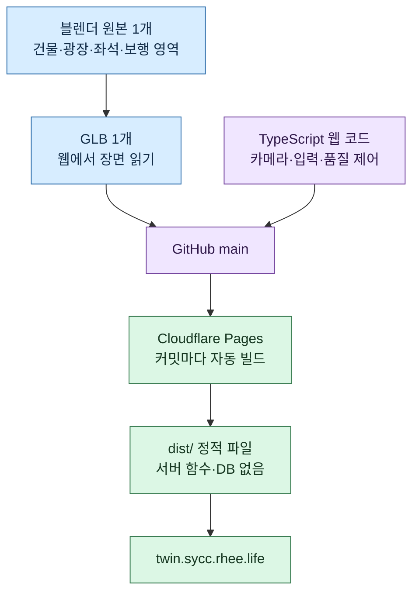

# 첫 정적 공개판 개발·검증 기록

## 이 작업을 만든 이유

개인적인 3D 제작 경험을 살려 수원청소년문화센터를 알리고, 12월 초 학교의 교육 방문 전에 낯선 시설의 광장·입구·로비를 미리 이해하는 데 도움이 되는 모형을 만들었다. 방문지 안내를 대신하는 공식 서비스가 아니다. 앞으로 대중교통과 시설 사이의 길을 연결하는 것은 별도 단계다.

## 사용자 눈에 보이는 변화

- 첫 외관에는 광장·연수동·온누리의 큰 덩어리와 유리 정면을 담았다. 현장 사진을 찾아 중앙 관통로, 낮은 삼각박공, 외부계단, 광장의 검정 띠 원주를 더했다.
- 2017년 객석도 두 장을 직접 읽어 1층 번호 356개, 2층 163개 및 휠체어 공간 6곳을 구분했다. 건축·재료 치수는 모른 상태이므로 숫자와 모양의 근거를 분리했다.
- 다른 시기에 찍힌 실내 사진에서 붉은 객석과 목재색 측벽, 밝은 슬랫 후벽을 확인했다. 임시 회색 객석을 바꾸고 로비 유리가 객석 뒤를 비추던 공간 경계를 막았다.
- 실내에서는 모든 곳을 통과하게 하지 않는다. 로비 바닥과 경계가 모델에 정해진 곳만 걷는다. 객석과 발코니는 바로가기 카메라로 볼 수 있지만 거기까지 걸어가는 통로는 이번 판에 없다.

## 보행은 어떻게 구현했나

Blender에서 만든 `WalkRegion_OnnuriLobby`라는 표시를 GLB가 그대로 전달한다. 이 표시가 없거나 좌표·눈높이·바닥 값이 잘못되면 보행 버튼을 표시하지 않는다. 입력 방향을 정규화해 대각선만 빨라지지 않게 하고, 모형의 로비 보행 영역 경계 밖으로 나가지 않도록 제한한다. 고정 눈높이를 사용하며 떨어지거나 문을 통과하는 물리 시뮬레이션은 하지 않는다. 조작을 놓거나 페이지 포커스를 잃으면 입력이 초기화된다. 화면 버튼·키보드·마우스를 제공한다.

25지점에서 모델 바닥의 높이를 측정해 고른 로비 바닥이 맞는지 확인했다. 이 검사로 실제 현장 접근성이나 계단 이동이 보증되는 것은 아니다. 건축 사진으로 확인하지 못한 통로나 기계실을 실제인 것처럼 추가하지 않았다.

## 파일과 정적 배포 흐름

GitHub 저장소 `hslcrb/twin.sycc.digital`의 `main`만 프로덕션에 자동 게시한다. Pages 빌드 명령은 `npm ci && npm run build`, 결과 폴더는 `dist`다. 별도 업로드 방식이나 Worker 코드, API 서버를 사용하지 않는다. 도메인 운영 주소는 `twin.sycc.rhee.life`다. 스틸컷과 자료 목록은 GitHub 문서에 보관하고 첫 웹 요청에서 함께 내려받지 않는다.

## 검증과 남은 작업

M4 자산은 [매니페스트](model-manifest.json)와 [Blender 독립 검사](model-verification.json)에 기록했다. 단일 GLB는 **1,470,400바이트**이고, 좌석 수·일치하는 여섯 시점·로비 바닥을 검증했다. TypeScript와 Vite 빌드, 실제 GLB를 Three.js로 읽는 뷰어 테스트와 바이너리 검사로 확인한다. 인게임 프레임률, 실제 시설 길찾기, 수영장·체육관의 전 구획을 완료했다고 주장하지 않는다.

유리는 지금 단계에서 PBR 색과 투명도를 근사했고, 웹 하늘은 가벼운 배경이다. 사진 기반 미세 텍스처나 HDR 전 방향 반사, 실제 저사양 휴대폰 수치를 얻으려면 추가 제작·검증이 필요하다. 자료 출처와 현재 구현이 다른 부분은 [스틸컷 기록](STILLS.ko.md), [최근 현장 사진 관찰](RECENT-REFERENCES.ko.md), [상세 마일스톤](MILESTONES.ko.md)에 계속 남긴다.
