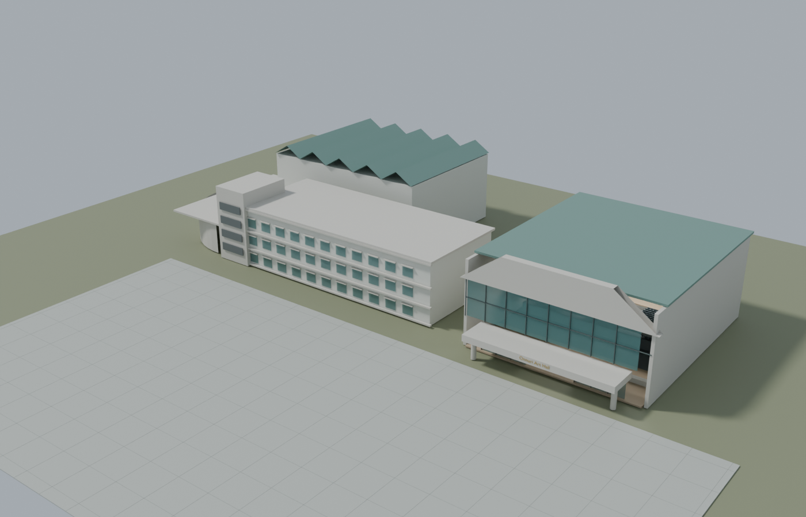
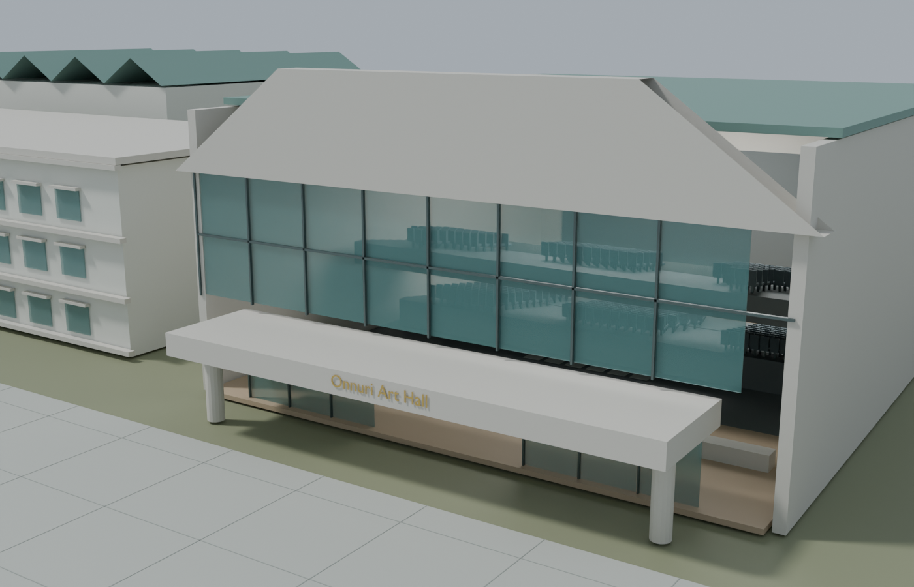
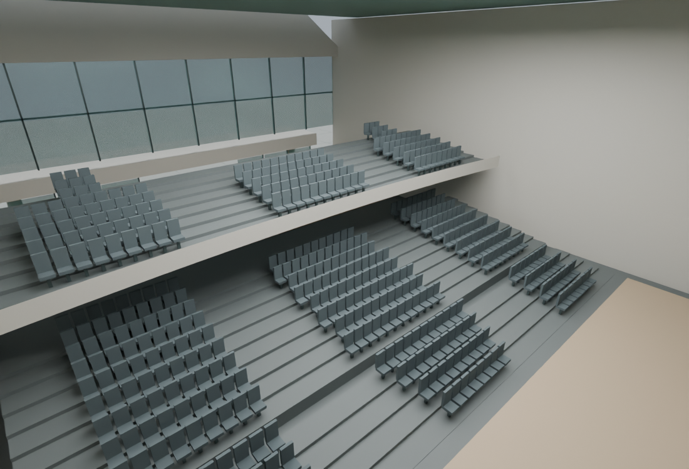
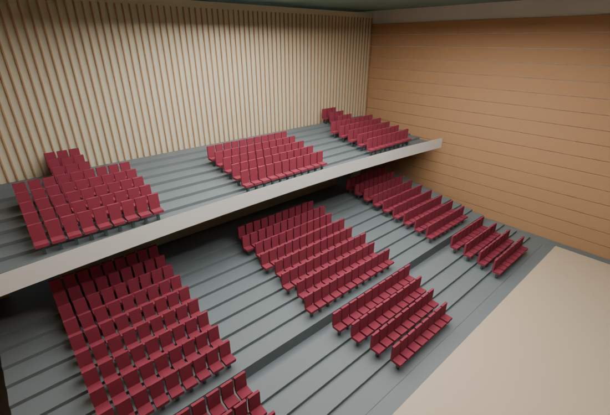
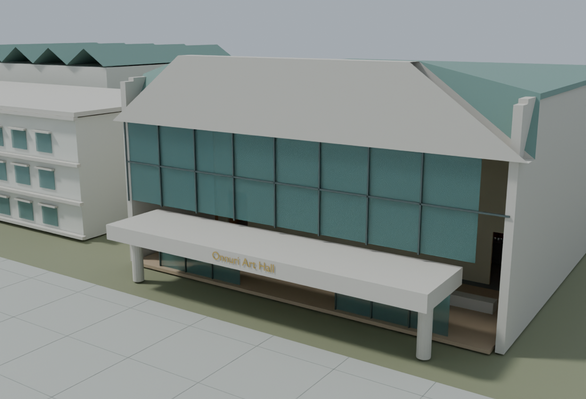
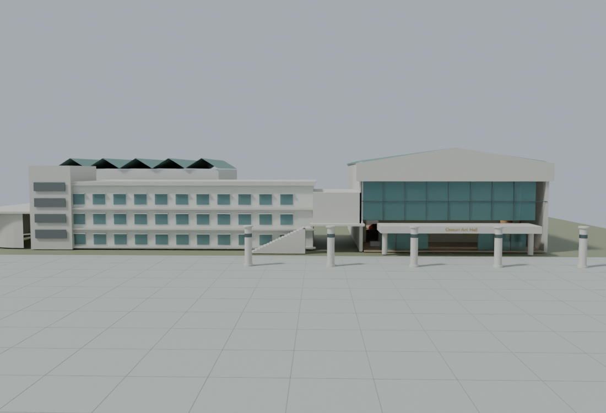

# Blender 스틸컷 작업 기록

모든 이미지는 프로젝트의 실제 Blender 장면을 렌더한 결과다. 참고 출처의 사진 원본이나 이미지 생성형 삽화는 수록하지 않았다. 모델과 좌석의 현재 치수, 재료, 조명까지 실측한 장면으로 해석하면 안 된다.

## M1–M2: 부지 골격과 객석도 대조

### 부지와 광장

광장 격자와 주요 볼륨을 잡은 단계. 관측한 창열 리듬과 지붕 실루엣을 재현하되 건물별 정확한 위치·외곽은 미확인이다.

### 온누리 입구

투명 재질과 석재 느낌을 나눴다. 실측 유리의 반사값이나 박공의 정확한 비례는 아니다.

### 객석 구획

2017년 공개 객석도 기준의 1·2층 구획과 좌석 수를 확인한 컷이다. 회색은 형상을 읽기 위한 임시 재료다.

## M3: 현장 사진을 보고 실내 재료 개선

좌석 수는 유지한 채 붉은 좌석, 목재 계열 측벽, 밝은 슬랫 후벽을 반영했다. 공연장 뒤에 로비 유리가 그대로 비치던 모델의 공간 경계를 분리했다. 실제 난간·천장과 조명은 아직 재현 대상이다.

발전 과정 기록이다. 이전 외관 컷과 달리 상부 지붕 연결을 닫았지만, 실사진의 전면 박공과 폭·깊이 비례까지 확인한 상태는 아니다.

## M4: 전면 비교

2026년 공개 사진에서 확인된 특징을 반영했다. 낮은 삼각박공과 열린 중앙 관통로, 외부 계단 실루엣을 넣었다. 원주의 정확한 갯수·배치나 계단 치수는 현장 실측값이 아니다.

## 새 컷을 넣는 기준

렌더한 모델 커밋, 카메라 방향, 변경한 요소와 남은 차이를 함께 남긴다. 원본 렌더는 문서 폴더에 두고 정적 웹 최초 로딩에는 넣지 않는다. 같은 프레이밍을 보존해 전후 비교가 가능하도록 한다.
